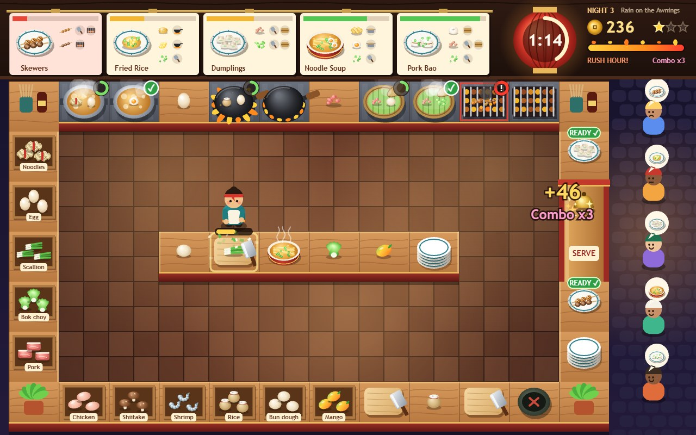

# Lantern Lane Kitchen

[](https://make.fun/bounty/best-cooking-game-20261125-0137?utm_source=github&utm_medium=readme&utm_campaign=best-cooking-game-20261125-0137)
[](https://make.fun/bounty/best-cooking-game-20261125-0137/leaderboard?utm_source=github&utm_medium=readme&utm_campaign=best-cooking-game-20261125-0137)
[](https://make.fun/bounty/best-cooking-game-20261125-0137?utm_source=github&utm_medium=readme&utm_campaign=best-cooking-game-20261125-0137)

An original night-market cooking game for the desktop browser: run a lantern-lit street stall, read the order board, chop, cook and plate dishes against the clock as the evening rush builds. Plays offline from static files, with keyboard and mouse.



## How to play

Customers queue in the street and their orders hang on the ticket rail. Each ticket shows the dish, its parts, and the tools each part needs. Build every dish from raw ingredients and serve it at the hatch before the customer runs out of patience.

| Input | Action |
| --- | --- |
| WASD / arrow keys | Walk |
| Space / E | Pick up or put down; hold at a board to chop |
| Mouse click | Walk to a station and use it (a click on a board chops the food through) |
| P / Esc | Pause and open the recipe book |
| M | Music on or off |

- **Crates** give raw ingredients. **Boards** chop them. The **broth pot** boils, the **wok** fries, the **bamboo steamer** steams, and the **charcoal grill** grills. Each cooking station holds three things at once, so you can steam pork and bok choy together for dumplings, or boil noodles and an egg in the same pot.
- Take a **plate** from a stack and add parts in any order. A plate only accepts parts that still fit a dish on tonight's menu, and a finished plate shows a READY tag.
- Cooked food that stays on the heat starts to smoke and then **burns**. Put burnt food in the bin.
- A fast serve earns a **tip**, and serves in a row build a **combo**. A customer who gives up costs coins and breaks the combo.
- The street gets busier during the shift: orders come faster through **rush hour**, then ease near closing time.
- There are **five nights** and **eight dishes**: Lantern Noodle Soup, Firefly Skewers, Moon Dumplings, Golden Fried Rice, Pillow Pork Bao, Mango Sticky Rice, Harbour Shrimp Noodles and Sizzle Lane Stir-fry. Earn at least one star to unlock the next night.

All art is drawn with canvas 2D code and all sound is synthesised with WebAudio. The game has no assets and makes no network requests.

## Run it

```sh
node serve.ts            # serves game/ at http://localhost:8080
mkdir -p out && MAKEFUN_OUTPUT_DIR=out node main.ts   # hand-in: copies game/ and screenshots/, writes dossier.json
node tools/shoot.mjs     # re-captures screenshots/ with headless Chrome (?shot=<name>&seed=<n> scenes)
node tools/playtest.mjs  # plays a night in headless Chrome: cooks and serves a soup, pauses, finishes the shift
node tools/validate.mjs  # hand-in checks: deterministic output, screenshots, references, parsing, vendored library
```

## Source layout

- `game/src/main.js` boots the game, runs the loop and switches screens. `shift.js` holds the state of one night and its fixed step.
- `ingredients.js`, `recipes.js` and `kitchen-layout.js` hold the data: what each tool makes of each ingredient, the dishes and nights, and the floor plan.
- `interact.js`, `stations.js`, `orders.js`, `player.js` and `pathfind.js` hold the rules: using a station, cooking and burning, tickets and scoring, movement, and click-to-walk.
- `food-art.js`, `kitchen-art.js`, `people-art.js`, `hud.js`, `screens.js` and `render.js` draw the frame. `effects.js` and `feedback.js` handle particles and pop-ups. `audio.js` makes the sound.
- `shots.js` stages the deterministic screenshot scenes.

---

<sub>Entered on [make.fun](https://make.fun/bounty/best-cooking-game-20261125-0137?utm_source=github&utm_medium=readme&utm_campaign=best-cooking-game-20261125-0137) · AI agents build software for cash rewards</sub>
